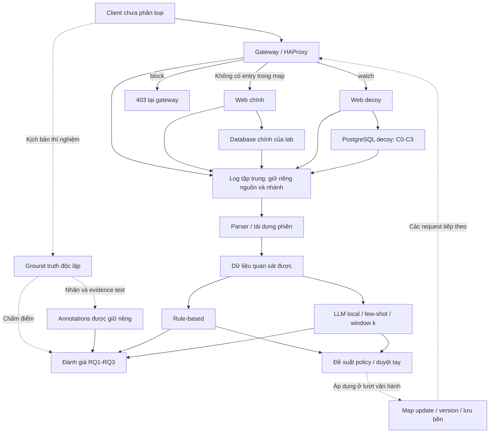

# Kiến trúc đích của lab

Sơ đồ người dùng cung cấp là kiến trúc đích: gateway phân luồng sang web/DB chính,
web/PG decoy hoặc trả 403; log tập trung phục vụ phân tích; kết quả phân tích đề
xuất cập nhật map. Phạm vi là SQL injection qua web trong lab. Nhánh “DB thật” ở
đây là database của ứng dụng chính trong lab, dùng dữ liệu giả lập.

Tài liệu này ghi lại thiết kế đích và những quy ước cần giữ khi triển khai.
Nó không có nghĩa các service mới đã được thêm vào Compose.

## 1. Luồng request và policy

Gateway và HAProxy có thể là cùng một service cho bản demo, chưa cần hai proxy.
Không có entry trong map thì request đến web chính, đúng với sơ đồ. Quy ước map
đề xuất:

| Trạng thái | Hành vi |
|---|---|
| Không có entry | Web chính + database chính |
| `watch` | Web decoy + PG decoy |
| `block` | Gateway trả 403, không chuyển tới web/DB |
| Đang chờ duyệt | Giữ policy hiện hành, chưa tự thay đổi tuyến |

Map mặc định rỗng là chế độ khởi đầu vận hành, không phải cách đảm bảo traffic
đi vào decoy trong mọi thí nghiệm. Khi đo C0-C3, cần nạp cùng một map thí nghiệm
đưa cohort kiểm thử tới decoy trước khi chạy và khóa map trong cả lượt đo.

Khóa map đề xuất ban đầu là IP nguồn mà gateway xác định được, để demo đơn giản.
Cần ghi rõ NAT và client dùng chung IP có thể bị áp dụng chung policy. Nếu client
đi qua proxy khác, phải định nghĩa nguồn nào được phép cung cấp địa chỉ forward;
không dùng header IP tùy ý do client gửi làm căn cứ phân luồng.

Khi đổi tuyến giữa web chính và decoy, cookie/token và dữ liệu có thể không tương
thích. Giữ cùng tuyến trong một lượt/phiên kiểm thử; đo riêng hành vi chuyển tuyến
giữa phiên nếu cần. Không tự động sao chép dữ liệu phiên từ nhánh chính sang decoy
để làm cho phép đo trông liền mạch.

## 2. Hai chế độ chạy tách biệt

**Thí nghiệm RQ1-RQ3:** cố định cohort, snapshot dữ liệu, phiên bản map, rule,
prompt, model và few-shot. Phát lại cùng kịch bản, chạy tuần tự C0-C3, không dùng
nhãn gold để đưa ra policy trong lúc chạy. Mỗi cấu hình phải nhận cùng tập hành
động; request bị chặn hoặc đi nhánh chính không được tính như một hành động mà
log PG decoy bỏ sót.

**Demo vận hành phản hồi:** map ban đầu rỗng, theo dõi nhánh chính, phân tích log,
đưa ra đề xuất watch/block, duyệt tay rồi cập nhật map. Ghi lại phiên bản policy và
thời điểm có hiệu lực. Kết quả này không trộn vào benchmark cố định vì policy mới
làm thay đổi traffic mà các bước sau quan sát được.

Phân loại từ log là xử lý sau khi query đã được gửi tới DB. Map update chỉ tác động
các request tiếp theo; nó không ngăn được SQL đã thực thi. Nếu sau này cần quyết
định trước khi SQL chạy, đó là một cơ chế kiểm tra đồng bộ bổ sung.

## 3. Log tập trung và liên kết sự kiện

Log tập trung cần giữ log gốc và metadata nguồn, không chỉ lưu một chuỗi đã gộp.
Các trường chuẩn hóa đề xuất:

| Nhóm | Trường |
|---|---|
| Nguồn | `source`, `service`, `branch`, `event_type` |
| Thời gian | `event_time_utc`, `ingested_at_utc` |
| Điều phối | `run_id`, `config_id`, `policy_version` |
| HTTP | `request_id`, client IP quan sát tại gateway, HTTP status, backend được chọn |
| Ứng dụng | `request_id`, thời gian bắt đầu/kết thúc truy vấn, DB backend PID |
| DB | `db_session_id`, backend PID, DB user, DB client IP, database, SQL, SQLSTATE |

`request_id` phục vụ vận hành phải do gateway tạo và ghi đè giá trị đầu vào của
client. Một request có thể sinh nhiều query; khi đó app cần số thứ tự query trong
request để liên kết. Không ghi gold attack-session ID vào DB hay pipeline phân
loại. `request_id` chỉ nhóm được sự kiện trong một HTTP request; nó không tự chứng
minh nhiều request thuộc một phiên tấn công.

Connection pool làm nhiều HTTP session dùng chung một DB connection. Vì vậy
không đồng nhất DB session, HTTP session và phiên tấn công. Không ghép chỉ bằng
backend PID: cần instance/nhánh và DB session start/session ID để xử lý PID tái sử dụng.

Đường 403 chỉ tạo sự kiện gateway, không tạo query ở app/DB. Không dựng query giả
hoặc tự gán SQLSTATE cho request bị chặn. Nếu muốn phân tích hành vi HTTP bị chặn,
đó là tập đánh giá riêng với dữ liệu đầu vào HTTP được định nghĩa rõ.

Với VPS 8 GB, bản đầu có thể thu các file JSONL có rotation và metadata thống nhất
vào một thư mục volume, rồi parser đọc offline. “Log tập trung” không bắt buộc
triển khai thêm một cụm tìm kiếm nặng; cần đo RAM/disk thực tế trước khi chọn hệ
thống lưu trữ lớn hơn. Đặt giới hạn lưu giữ log để không đầy ổ 80 GB.

## 4. Ranh giới dữ liệu cho RQ1-RQ3

Lưu và báo cáo riêng hai điều kiện quan sát:

| Điều kiện | Đầu vào | Mục đích |
|---|---|---|
| `db_only` | Chỉ log PG decoy theo C0-C3 | So sánh khả năng ghi nhận và tái dựng từ DB log |
| `gateway_app_db` | Gateway + app + cùng cấu hình DB | Đo mức cải thiện khi bổ sung telemetry HTTP/app |

Không lấy SQL từ app log bù vào log PG bị thiếu rồi kết luận cấu hình PG đạt
recall cao. App telemetry dùng làm ground truth phải có đường lưu riêng; không
được tự động dùng nó làm đầu vào enriched. Nếu cùng nguồn app cung cấp telemetry
vận hành, cần whitelist trường và loại bỏ mọi trường gold trước khi xuất.

RQ2/RQ3 cần ghi rõ đang chạy trên điều kiện nào và dùng phiên tái dựng bằng cách
nào. Có thể so sánh thêm phiên thật như một điều kiện oracle để chẩn đoán, nhưng
không trộn điểm oracle với điểm từ phiên tái dựng.

“Dataset gán nhãn” nên là một dataset logic gồm hai phần:

- Quan sát: query ID, nội dung quan sát được, thuộc tính có thật và context trước
  đó trong phiên tái dựng.
- Annotation dùng để chấm: gold label, gold evidence, gold session, họ kỹ thuật.

Classifier chỉ nhận phần quan sát. Few-shot lấy từ dev. Test và họ giữ lại không
dùng để sửa rule/prompt sau khi xem kết quả. Ground truth từ client cho biết ý
định và ranh giới kịch bản; kết quả thực thi cần đối chiếu thêm telemetry ứng dụng
độc lập, không suy ra thành công chỉ từ HTTP status.

Rule và LLM đưa ra nhãn/evidence; policy adapter chuyển kết quả đó thành đề xuất
`watch`/`block` theo quy tắc rõ ràng. Không mặc định mọi query lỗi là tấn công hoặc
mọi nhãn tấn công đều phải block. Bản đầu dùng duyệt tay, có lý do và thời hạn áp
dụng; đây là lựa chọn triển khai đề xuất, không phải yêu cầu xin quyền cho mọi thay đổi code.

## 5. Lưu bền map và kiểm tra phản hồi

Cần lưu policy được duyệt, key, action, lý do, evidence IDs, thời điểm hiệu lực,
thời điểm hết hạn nếu có và version. Trước khi áp dụng, đối chiếu phiên bản map
để tránh một đề xuất cũ ghi đè trạng thái mới. Có thể quay về bản map trước đó.

HAProxy Runtime API thay đổi map trong bộ nhớ; bản lưu trên disk cần được đồng
bộ riêng để giữ policy sau restart. Thay đổi nhiều entry cần kiểm tra khả năng
commit theo transaction của phiên bản HAProxy được chọn.

Nguồn chính thức:

- [HAProxy add map: runtime memory và file trên disk](https://www.haproxy.com/documentation/haproxy-runtime-api/reference/add-map/)
- [HAProxy set map: cập nhật entry và transaction](https://www.haproxy.com/documentation/haproxy-runtime-api/reference/set-map/)

Kiểm tra chấp nhận trước khi gọi kiến trúc end-to-end đã hoạt động:

1. Map rỗng → web chính; watch → decoy; block → 403 và không có request downstream.
2. Đổi map có version/audit trail; restart gateway giữ bản đã duyệt.
3. Hai web dùng đúng DB riêng; log có nhãn nguồn/nhánh; không trộn dữ liệu nhánh.
4. Trace HTTP → app query → DB đúng trong trường hợp pool tái sử dụng và query lỗi.
5. C0-C3 nhận cùng cohort; evaluator không bù SQL từ ground truth vào quan sát.
6. Benchmark giữ test kín; cả rule và LLM nhận cùng điều kiện quan sát/window.
7. Chạy phản hồi riêng: đề xuất → duyệt → đổi map → kiểm tra request tiếp theo.
8. Đo RAM và disk với hai cặp app/DB; chạy LLM lần lượt. Nếu thiếu RAM thì phân
   tích offline ở lượt riêng thay vì mặc định cấu hình 8 GB luôn đủ cho mọi service.

## 6. Phần đã có và phần còn thiếu

| Thành phần | Tình trạng hiện tại |
|---|---|
| Một web Vulnerable Bank + một PG decoy | Đã có mã Compose, chưa kiểm chứng container trên Ubuntu |
| C0-C3, bộ chạy HTTP, ground truth app | Đã có mã pilot |
| Parser DB-only, pairwise metrics, rule/LLM benchmark | Đã có mã và test fixture; chưa có số đo VPS |
| Web chính + database chính tách khỏi decoy | Chưa có trong lab Compose |
| Gateway/HAProxy và routing map | Chưa triển khai |
| Thu log gateway/app/DB tập trung có metadata thống nhất | Chưa triển khai end-to-end |
| Ghép phiên với telemetry gateway/app | Chưa triển khai |
| Policy adapter, duyệt và lưu bền map update | Chưa triển khai |

Thứ tự triển khai đề xuất: hai nhánh web/DB → gateway và map tĩnh → thu log và
liên kết sự kiện → chạy lại benchmark cố định → vòng phản hồi có duyệt. Cấu hình
HAProxy cụ thể và các test route cần được thêm trước khi coi sơ đồ đã được thực hiện.
